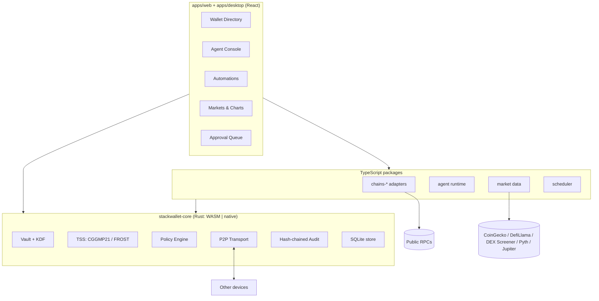
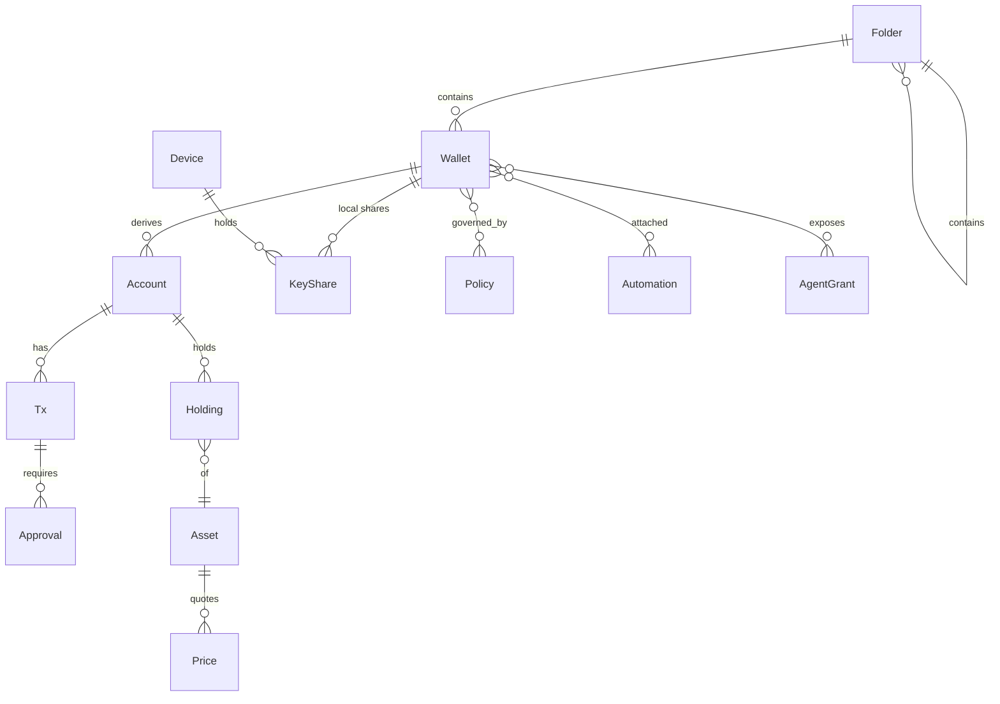
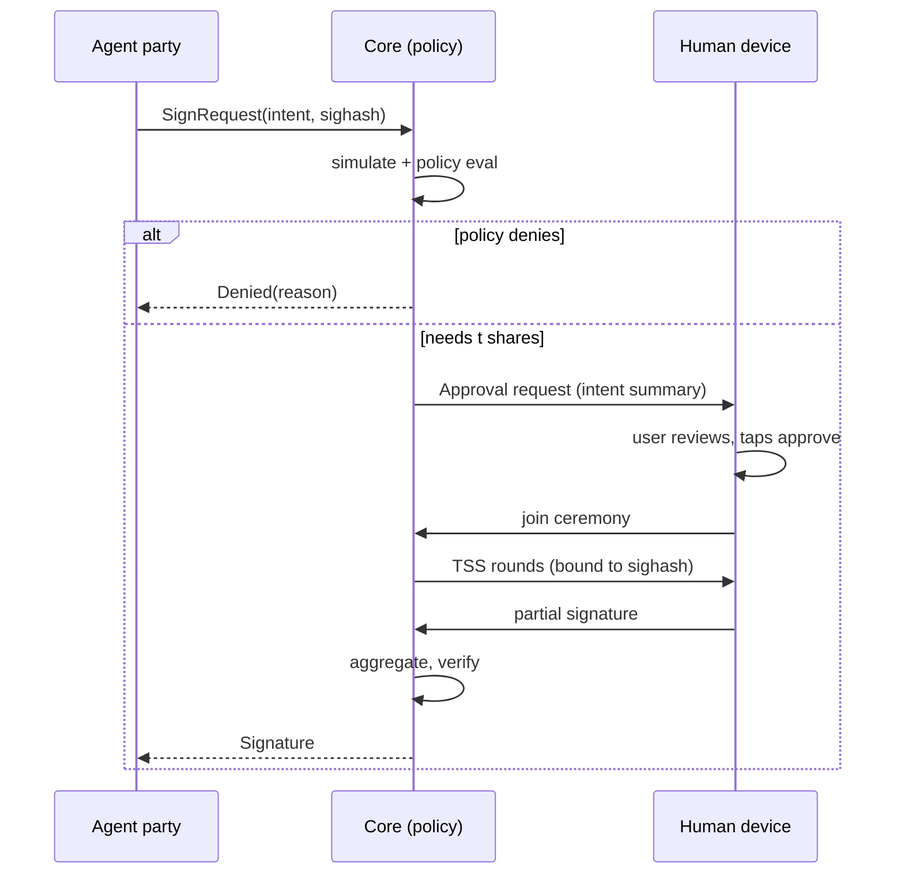
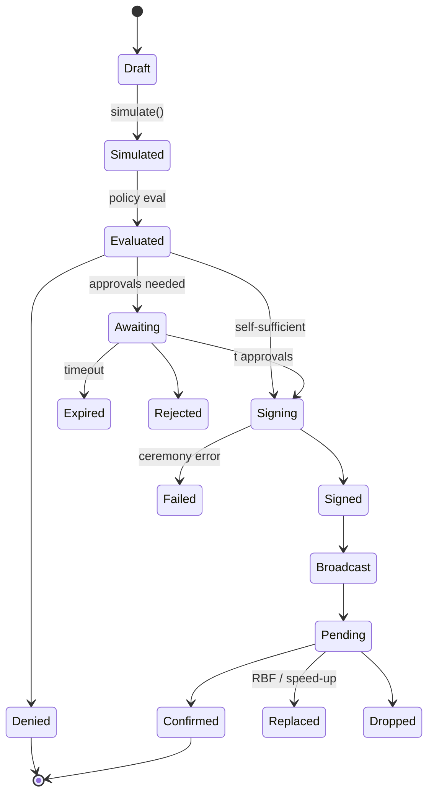

# StackWallet — Specification

Version 1. Companion documents: `SECURITY.md` (threat model), `DESIGN.md` (visual system),
`CHAINS.md` (adapter contract and per-family notes). Locked decisions D1–D9 are listed in
`AGENTS.md` and repeated in section 1; everything else in this document is open to revision.

## 0. What StackWallet is

StackWallet is an agentic harness for crypto wallets. It looks like any other agent harness
(a console where a model plans and calls tools, with the operator approving what matters), but
the tools act on wallets, and the wallets exist on every chain family: EVM, Bitcoin, Solana,
Cosmos, and whatever comes next.

Three ideas make it different from a wallet with a chatbot bolted on:

1. **The directory.** Wallets live in folders and subfolders. A folder carries policies,
   automations and agent grants that its children inherit. You can keep a "Trading / Agent
   lanes / Solana memecoins" folder with tight caps next to a "Cold / Savings" folder nothing
   automated can touch.
2. **Threshold custody as the permission system.** A `tss` wallet's key is split into shares
   held by your devices and, optionally, by the agent runtime. The agent can only ever be one
   party, and every threshold that includes it also needs a non-agent share. "The agent needs my
   approval to spend" is therefore a property of the math, not of a checkbox.
3. **Local-first, no server.** Every byte of state lives on your devices. Devices talk to each
   other directly for sync and signing ceremonies. Prices come straight from public APIs.

Platforms: web app (static bundle) and Tauri 2 desktop first; Android/iOS later through the
same Rust core (UniFFI).

## 1. Locked decisions

| #   | Decision                                                                                                                                                                                                    |
| --- | ----------------------------------------------------------------------------------------------------------------------------------------------------------------------------------------------------------- |
| D1  | Threshold signatures from day one. CGGMP21 for secp256k1 ECDSA (EVM, Bitcoin legacy/SegWit, Cosmos), FROST for Ed25519 (Solana) and secp256k1-Taproot (Bitcoin Schnorr).                                    |
| D2  | Rust core owns key material, encryption, TSS, the policy engine, transport and the audit log. WASM for web, native for Tauri, UniFFI later. TypeScript owns UI and chain-SDK glue only.                     |
| D3  | No server. Device-to-device sync and ceremonies (LAN discovery + WebRTC, QR pairing). Client-side market data.                                                                                              |
| D4  | BYOK cloud model providers (Anthropic, OpenAI, Google, OpenRouter) via the Vercel AI SDK. Keys live in the vault. Local models are a later provider.                                                        |
| D5  | V1 chain families: EVM (any chain via registry), Bitcoin family (BTC, LTC, DOGE), Solana, Cosmos SDK (+IBC).                                                                                                |
| D6  | The agent cannot move funds alone: at most one TSS party, and every agent-inclusive threshold requires a non-agent share. Enforced by the core at wallet creation and re-checked by policy at signing time. |
| D7  | Night glass design family by default; user themes (NurCLI presets, per-token edits, per layout) are opt-in (see `DESIGN.md`).                                                                               |
| D8  | No telemetry, analytics or remote fonts. Reproducible builds.                                                                                                                                               |
| D9  | No time estimates anywhere. Phases only.                                                                                                                                                                    |

## 2. Architecture



### 2.1 Trust boundaries

- **Core** (Rust): the only code that touches shares, seeds, the data encryption key, or the
  policy decision. Exposed to TypeScript as opaque handles plus JSON-serializable requests and
  results. Never returns secret bytes.
- **Chain adapters** (TypeScript): build unsigned transactions, compute sighashes, simulate,
  assemble signatures, broadcast. They receive public keys and signatures only.
- **Agent runtime** (TypeScript): receives tool results and proposal status. Never receives
  keys, shares, RPC credentials, or provider keys in plaintext (the runtime asks the core to
  sign provider requests' authorization headers through a scoped handle).
- **UI** (React): renders state from the store and sends intents. UI checks are convenience;
  the core re-validates everything.

### 2.2 Runtime shapes

| Surface                 | Core runs as               | Store                             | Transport                                                                             | Scheduler                                     |
| ----------------------- | -------------------------- | --------------------------------- | ------------------------------------------------------------------------------------- | --------------------------------------------- |
| Browser                 | WASM in a dedicated Worker | SQLite-WASM over OPFS             | WebRTC data channels; SDP via a paired desktop on the LAN or via QR/paste             | Only while a tab is open (UI says so)         |
| Desktop (Tauri 2)       | Native, in-process         | rusqlite file in the app data dir | mDNS discovery + direct TCP with Noise; also acts as LAN signaling point for browsers | Background (tokio)                            |
| CLI (`stackwallet-cli`) | Native                     | rusqlite file                     | Same as desktop, headless                                                             | Background; the recommended automation device |
| Mobile (later)          | Native via UniFFI          | SQLite                            | WebRTC / LAN                                                                          | Push-less: foreground + OS background tasks   |

## 3. Repository layout

```
StackWallet/
  AGENTS.md
  docs/SPEC.md  SECURITY.md  DESIGN.md  CHAINS.md
  crates/
    stackwallet-core/        model, intent, policy, lifecycle, audit, vault, tss, transport, store
    stackwallet-wasm/        wasm-bindgen surface
    stackwallet-cli/         headless binary
  apps/
    web/                     Vite React SPA (static)
    desktop/                 Tauri 2 shell; `src-tauri` is the `stackwallet-tauri` crate
  packages/
    core-client/             TS types (Zod) + CoreClient over WASM or Tauri IPC
    chains/                  ChainAdapter contract, registry, shared tx model
    chains-evm/ chains-bitcoin/ chains-solana/ chains-cosmos/
    agent/  automations/  market/  ui/
```

Conventions: TypeScript strict; Zod at every boundary; INTEGER ms timestamps; TEXT uuid
primary keys; every lifecycle transition writes `audit_log`.

## 4. Domain model



### 4.1 Entities

**Folder** `{ id, parentId?, name, color?, tags[], defaultPolicyIds[], createdAt, updatedAt }`
Unlimited depth. Policies and tags are inherited by children; the effective policy of a wallet is
the composition of every ancestor folder's policies, its own, and the active grant's overlay.

**Wallet** `{ id, folderId, name, kind, keyGroupId?, tags[], notes?, createdAt, updatedAt }`
Kinds:

- `tss`: threshold wallet over a `KeyGroup` (t-of-n). One key per curve (secp256k1-ecdsa,
  ed25519, secp256k1-tr), so one wallet exposes accounts on every chain family.
- `single`: BIP39 seed, BIP32/SLIP-10 derivation, encrypted locally. For imports and throwaways.
- `watch`: addresses only, no signing.
- `hardware`: Ledger (WebHID / HID) as signer. Later phase.

**KeyGroup** `{ id, threshold, parties: PartyRef[], curves: Curve[], publicKeys: Record<Curve, hex>, createdAt, refreshedAt }`
`PartyRef = { deviceId, role: 'human' | 'agent' | 'automation' }`. Invariant (D6): if any party
has role `agent`, then `threshold > count(parties where role === 'agent')`.

**Account** `{ id, walletId, family, chainId, address, derivationPath?, publicKey, label? }`
Derived from the wallet's public key for the family's curve. Accounts can be hidden but never
deleted while they have history.

**KeyShare** (core-private) `{ id, keyGroupId, curve, deviceId, encryptedShare, createdAt }`
Never leaves the core in plaintext. Backups are share-level and encrypted to a recovery passphrase.

**Device** `{ id, name, kind: 'desktop' | 'browser' | 'cli' | 'mobile', identityPubKey, pairedAt, lastSeenAt, endpoints[] }`
Identity key is Ed25519, generated at install, held in the vault. Pairing pins both identities.

**Policy** `{ id, name, rules: Rule[], mode: 'enforce' | 'audit' }`
Rules (all evaluated deterministically in the core; see section 7):

- `spendCap { window: 'tx' | '1h' | '24h' | '7d' | '30d', usd?: number, native?: { chainId, amount } }`
- `destinationAllow { addresses[] }`, `destinationDeny { addresses[] }`
- `chainAllow { chainIds[] }`, `contractAllow { chainId, addresses[] }`
- `assetAllow { assetRefs[] }`
- `timeWindow { tz, days[], startMinute, endMinute }`
- `maxSlippageBps { bps }`
- `requireSimulationPass {}`
- `requireApprovers { deviceIds[], atLeast }`
- `cooldown { seconds }`
- `maxPendingProposals { count }`
  Composition: most restrictive wins (caps are min'd, allowlists are intersected, denylists are
  unioned, requirements are unioned).

**AgentGrant** `{ id, name, walletIds[] | folderIds[], toolAllow[], policyOverlayId?, providerId, modelId, createdAt, expiresAt? }`

**Automation** `{ id, name, walletIds[], trigger, conditions[], action, policyOverlayId?, enabled, lastRunAt?, nextRunAt? }`
See section 10.

**Tx** `{ id, accountId, chainId, intent, unsigned?, simulation?, state, approvals[], hash?, error?, createdAt, updatedAt }`
See section 6.

**Asset** `{ ref: "<chainId>:<kind>:<identifier>", symbol, name, decimals, logo?, sources{} }`
Examples: `eip155:1:erc20:0xa0b8…`, `bip122:000000000019d6689c085ae165831e93:native`,
`solana:5eykt4UsFv8P8NJdTREpY1vzqKqZKvdp:spl:EPjF…`, `cosmos:osmosis-1:ibc:27394F…` (the `ibc/`
prefix of the on-chain denom is folded into the kind). Chain ids follow CAIP-2.

**Price** `{ assetRef, quote: 'usd', value, source, fetchedAt, confidence }`
**Holding** `{ accountId, assetRef, amount, updatedAt }`

### 4.2 Storage

Interim: until the encrypted store ships, the web app keeps the directory (folders, wallets,
watch-only accounts, no secrets) as a Zod-validated JSON blob in `localStorage`
(`stackwallet.directory.v1`). The per-chain RPC endpoint lists edited in the Network view are
kept the same way under `stackwallet.rpc.v1`. Nothing sensitive is ever written there; the
vault below replaces it.

SQLite everywhere (rusqlite natively, SQLite-WASM over OPFS in the browser). The whole database
is encrypted at rest with XChaCha20-Poly1305 using a data encryption key (DEK). The DEK is
wrapped by Argon2id(passphrase) and optionally by a platform unlock (WebAuthn PRF in the browser,
OS keychain / Windows Hello on desktop). Share material is additionally encrypted with a
per-share key derived from the DEK so a compromised DB export without the passphrase yields
nothing usable.

As implemented, a vault directory holds two files:

- `vault.json`: the secrets. KDF parameters and salt, the DEK wrapped under the Argon2id key
  (the parameters and salt are bound into the AEAD's associated data, so lowering them in the
  file breaks authentication), and one entry per secret (device identity seed, key shares,
  provider keys), each sealed under its own HKDF-SHA256(DEK, entry id) key with the id and
  label as associated data. A generation counter and an HMAC-SHA256 manifest tag (keyed from
  the DEK) over the counter and the ordered entry list are checked at unlock, so deleting,
  reordering or rolling back an entry fails authentication. Labels are plaintext metadata;
  ciphertext never is.
- `store.swdb`: the directory and bookkeeping. The live database is an in-memory SQLite image
  serialized on save and sealed as one XChaCha20-Poly1305 blob under HKDF-SHA256(DEK, store).
  The header (magic, format version, vault generation, nonce) is authenticated, and the CLI
  refuses a store whose generation does not match the vault's, so neither file can be rolled
  back on its own. Both files are written to a sibling temp file, fsynced and renamed into
  place.

Keeping secrets apart from metadata lets the store be re-encrypted and later synced without
touching key material. The `key_share` table in the store is reserved for the per-device model
once ceremonies run across devices; the in-process harness keeps shares as vault entries.

Sync between devices is a CRDT-free, explicit model: each device keeps its own DB; metadata
(folders, wallets, accounts, policies, automations, grants, tx records) is exchanged as signed
change sets over the P2P channel, last-writer-wins per row with vector clocks for conflict
visibility. Shares are never synced; they are created in place by DKG or moved by re-sharing.

## 5. Threshold signing

### 5.1 Protocols

| Curve                      | Chains                             | Protocol                                                  | Implementation         |
| -------------------------- | ---------------------------------- | --------------------------------------------------------- | ---------------------- |
| secp256k1 ECDSA            | EVM, Bitcoin legacy/SegWit, Cosmos | CGGMP21 (DKG, auxiliary info, presign, sign, key refresh) | `cggmp24` crate family |
| Ed25519                    | Solana (Sui/Aptos later)           | FROST                                                     | `frost-ed25519`        |
| secp256k1 Schnorr (BIP340) | Bitcoin Taproot                    | FROST                                                     | `frost-secp256k1-tr`   |

Each `tss` wallet runs DKG once per curve so one wallet covers all families. Key refresh rotates
share material without changing public keys; re-sharing changes the party set (device add or
remove) without changing public keys.

Implementation status. The FROST schemes are wired in the core through `frost-core` 3 with the
pure-Rust `k256` / `curve25519-dalek` backends and compile for native and `wasm32`. The ECDSA
scheme is not yet wired: the maintained CGGMP crate was renamed `cggmp21` → `cggmp24`, the
`cggmp21` 0.6 release depends on GMP through `rug` (no MSVC or wasm build), and `cggmp24` is only
published as a `0.7.0-alpha` pre-release without key refresh. `Curve::Secp256k1` stays in the
model; there is no `ThresholdScheme` driver for it, and the FROST driver and the CLI refuse it
with an explicit reason (`CoreError::Invalid`) until a stable `cggmp24` lands. Until then `tss`
wallets can hold Ed25519 and Taproot keys only. Blocking EVM and Cosmos accounts in a `tss`
wallet at creation time belongs to the directory phase, when wallet creation moves into the core.

### 5.2 Parties

- **Human devices**: desktop, browser, later phone. Unlock with the user's passphrase or platform
  unlock before a share participates.
- **Agent party**: a share scoped to the agent runtime on one device. It unlocks with an
  agent-scoped key (no user passphrase) but only after the grant's policy overlay passes.
- **Automation device**: the headless CLI on an always-on machine with its own policy.

Example setups:

- 2-of-3 `{laptop, phone, agent}`: the agent proposes and co-signs, a human finishes.
- 2-of-2 `{laptop, phone}`: savings; the agent can read but never sign.
- 2-of-3 `{automation-cli, agent, laptop}` with a tight overlay: an "autonomous lane" where
  automation and agent can complete small, allowlisted transactions without a human.
- 3-of-5 across trusted people's devices.

### 5.3 Transport (device-to-device only)

- **Pairing**: one device shows a QR (text form `stackwallet-pair:<base64url JSON>`) carrying
  `{version, deviceId, deviceName, kind, identityPubHex, noiseStaticHex, endpoints[],
oneTimeCodeHex, expiresAtMs}`; the other scans or pastes it. The scanner initiates
  `Noise_IKpsk2_25519_ChaChaPoly_BLAKE2s` against the issuer's static from the QR, with the
  one-time code as the PSK. Each device holds two keys derived from one vault-held seed: the
  Ed25519 identity key (signatures only) and an X25519 Noise static (HKDF label
  `stackwallet/v1/noise-static`). After the handshake both sides exchange a `Hello` frame signed
  with the identity key over the Noise handshake hash, which binds the channel to the identity.
  The resulting `Device` record (identity key, Noise static, endpoints) is pinned; the one-time
  code is forgotten after one successful handshake or at `expiresAtMs`. Pairing happens once;
  later sessions are `Noise_IK` against the pinned static and a handshake from an unpinned or
  revoked static is refused before any application byte is read.
- **Sans-IO core**: the core owns pairing, handshake, cipher state and framing as a `Session`
  state machine (`handle_incoming` / `take_outgoing`). Carriers only move length-prefixed
  ciphertexts: TCP on desktop and CLI, WebRTC data channels in the browser. All carriers
  therefore get the same authentication and replay protection.
- **Discovery**: desktop and CLI advertise `_stackwallet._tcp` via mDNS. Browsers cannot do mDNS,
  so a paired desktop acts as the LAN signaling point for browser peers (SDP offers/answers over
  the already-authenticated channel). Two browsers with no desktop exchange SDP via QR or paste.
- **Channel**: WebRTC data channels in the browser; direct TCP with Noise between desktop/CLI.
  Every protocol message is authenticated by the device identity and bound to a `sessionId` and
  the exact `SignRequest` hash, so a party cannot be tricked into signing a different payload
  mid-ceremony. Ceremony envelopes are signed end to end by their author, so a device that
  relays messages for others (the initiating CLI acts as a star hub) can delay or drop them,
  which only aborts the ceremony, but cannot forge or alter them. Because relayed envelopes are
  admitted against each receiver's own pinned table, every participant of a network ceremony
  must be paired with every other participant, not only with the hub. Session TTLs are checked
  when a ceremony proposal is admitted; mid-ceremony stalls are bounded by the carrier's idle
  timeout.
- **Resumption** _(not yet implemented)_: presignatures (CGGMP21) and nonce pre-commitment
  (FROST) let parties pre-commit
  so a phone's co-sign is one round when the request arrives. Ceremonies have a TTL; expired
  presignatures are discarded, never reused.



## 6. Transaction lifecycle



Rules:

- Every transition writes an `audit_log` row whose hash covers the previous row's hash, the tx id,
  the from/to states, the actor (device, agent session, automation) and a timestamp. The UI can
  verify the chain and shows a break as a red banner.
- `Draft → Simulated` is mandatory when any effective policy has `requireSimulationPass`; it is
  always attempted and a failed simulation is shown to approvers regardless.
- `Evaluated → Signing` without `Awaiting` happens only when the local device alone satisfies the
  threshold (single-key wallets, or a `tss` wallet whose threshold is met by local shares, which
  D6 forbids for agent-inclusive groups).
- Approval screens always show: decoded intent, simulated asset deltas, destination reputation
  (allowlist status, first-seen date for this directory), USD value, policy headroom remaining in
  each window, and who proposed it (human, agent session with rationale, automation run).

## 7. Policy engine

Pure, deterministic Rust (`stackwallet_core::policy`). Input: `TxIntent`, `Simulation?`,
`PolicyContext` (effective rules, spend ledger per window, clock, approver set online). Output:
`Decision::Allow { requiredApprovers }`, `Decision::Deny { reasons[] }`, or
`Decision::Audit { wouldDeny: reasons[] }` for `audit`-mode policies.

Properties the tests must hold:

- Composition is order-independent.
- A denylist always beats an allowlist.
- Caps are evaluated against the ledger including currently `Awaiting`/`Signing` transactions
  (reserved spend), not only confirmed ones.
- An agent-inclusive key group whose threshold could be met by agent shares alone is denied at
  evaluation time even if the wallet somehow exists (defense in depth for D6).

## 8. Chain adapters

Full contract and per-family notes in `CHAINS.md`. Summary:

```ts
interface ChainAdapter {
  family: ChainFamily;
  chains(): ChainInfo[];
  deriveAddress(pub: PublicKey, chain: ChainId): Address;
  getBalances(addr: Address, chain: ChainId): Promise<Holding[]>;
  getHistory(addr: Address, chain: ChainId, cursor?: string): Promise<Page<TxRecord>>;
  build(intent: TxIntent, chain: ChainId): Promise<UnsignedTx>;
  simulate(tx: UnsignedTx): Promise<Simulation>;
  sighashes(tx: UnsignedTx): SignRequest[];
  attach(tx: UnsignedTx, sigs: Signature[]): SignedTx;
  broadcast(tx: SignedTx): Promise<TxHash>;
  status(hash: TxHash, chain: ChainId): Promise<TxStatus>;
  rpc: RpcPool;
}
```

Swaps use aggregator quotes (0x / 1inch / LI.FI for EVM, Jupiter for Solana, Skip / Osmosis for
Cosmos) and still pass simulation and policy; `maxSlippageBps` is a policy rule, not a UI field.

## 9. Agent runtime

- **Providers**: Vercel AI SDK with `@ai-sdk/anthropic`, `@ai-sdk/openai`, `@ai-sdk/google`,
  `@openrouter/ai-sdk-provider`. Provider keys live in the vault; requests are signed through a
  scoped core handle so the runtime never holds the raw key.
- **Tools** (Zod-typed, all logged): `listWallets`, `getPortfolio`, `getPrice`, `getHistory`,
  `quoteSwap`, `proposeTransfer`, `proposeSwap`, `proposeContractCall`, `simulate`,
  `requestSignature`, `createAutomation`, `readChart`, `search` (optional, off by default).
  Any tool producing a `TxIntent` enters the lifecycle of section 6. The agent never receives a
  signer.
- **Run loop**: streamed tool-call loop with hard caps per session (max steps, max USD proposed,
  max pending proposals). Every proposal appears in the Approval Queue with the model's stated
  rationale and the exact tool arguments.
- **Grants**: a session runs under one `AgentGrant`. Pinning a session to a folder makes its
  grant equal that folder's wallets with that folder's policies.
- **Agent party**: a session may act as one TSS party only for wallets whose key group has an
  `agent` party on this device and whose grant permits it.
- **Untrusted input**: token names, calldata decodes, transaction memos, web content and tool
  results are untrusted. They are wrapped and labelled before reaching the prompt; destinations
  that come from such content and are not in the user's allowlists are flagged in the proposal.
- Sessions, transcripts and tool traces are stored locally and searchable.

## 10. Automations

- **Triggers**: `schedule(cron)`, `priceCondition(assetRef, op, value | percentOverWindow)`,
  `balanceCondition(accountId, assetRef, op, value)`, `chainEvent(polled log filter /
account change / UTXO arrival)`, `manual`, `agent`.
- **Conditions**: additional predicates evaluated at fire time (same evaluator as alerts).
- **Actions**: `transfer`, `swap`, `dca`, `rebalance(targetWeights)`, `sweepToCold`,
  `stake | claim`, `ibcTransfer`, `alertOnly`, `runAgentPrompt`.
- Each run yields `TxIntent`s that enter the lifecycle. An automation attached to a wallet whose
  threshold can be met by `{automation, agent}` shares is an **autonomous lane**; the UI labels it,
  and enabling it requires an explicit tight overlay (caps, allowlists, cooldown).
- Scheduler runs in the background on desktop and CLI; in the browser only while a tab is open,
  and the UI says so. Runs are idempotent by `(automationId, triggerKey)`.

## 11. Market data and charts

- **Sources** (client-side, per-source rate limiting and caching): CoinGecko (free tier),
  DefiLlama coins API, DEX Screener (long-tail DEX pairs), Pyth Hermes (low-latency majors),
  Jupiter price API (Solana), on-chain DEX quotes as the last resort. Every price carries
  `source`, `fetchedAt`, `confidence`; the UI shows provenance.
- **Asset registry** seeded from token lists (Uniswap, Jupiter strict, Cosmos chain-registry,
  CoinGecko id map) and extended by any asset seen in a holding.
- **Charts**: TradingView `lightweight-charts`. Candles from CoinGecko OHLC / DEX Screener /
  Pyth history. Portfolio value over time computed locally from holdings × historical prices;
  per-wallet, per-folder and global views; allocation and PnL breakdowns.
- **Alerts** reuse the automation condition evaluator.

### 11.1 Market elements

The workspace's element set grows toward a trading command center (the reference is Parsec's
Command Center; its query surface is mapped in
`github.com/api-evangelist/parsec-finance`). Each element names its keyless source first; an
element without one ships empty with the reason shown, never with a hidden paid dependency.

| Element        | Shows                                                        | Keyless source first                                  |
| -------------- | ------------------------------------------------------------ | ----------------------------------------------------- |
| `trades`       | live DEX trade feed: pair, side, size, maker/taker, venue    | DEX Screener, chain logs via the RPC pool             |
| `candles`      | OHLCV for a pair or asset (the existing canvas chart)        | CoinGecko OHLC, DEX Screener, Pyth history            |
| `positions`    | a wallet's LP and concentrated-liquidity positions, in range | on-chain position managers via the RPC pool           |
| `lending`      | supply/borrow rates and history per protocol and asset       | DefiLlama yields                                      |
| `nft floors`   | floor, holders, 1d/7d/30d floor change for held collections  | Blockscout collection data; marketplace APIs are BYOK |
| `holders`      | top holders of a token and the largest balance changes       | Blockscout token holders                              |
| `transfers`    | transfers with USD value, NFT flag and token icon            | Blockscout / explorer APIs, RPC logs                  |
| `transactions` | decoded transactions (function and arguments, §12.3)         | RPC receipts + local decoder                          |
| `trending`     | contracts with rising senders, gas and tx counts             | explorer stats where keyless                          |
| `metrics`      | binned volume, trade count and unique takers                 | derived from `trades`                                 |

Paid analytics APIs (Parsec, Nansen and similar) may be added as opt-in providers with the key
in the vault (as D4 does for model keys). They never become the default: they see every address
queried, and the ones without CORS cannot be called from the web build without a server (D3),
so they are desktop-only, called from the Rust side.

## 12. UI surfaces

1. **Directory**: tree sidebar (folders / subfolders / wallets), bulk tag and move, folder-level
   totals, policy badges, agent-access badges.
2. **Wallet**: accounts by chain, holdings, history, policies, automations, grants,
   share-holders and threshold health (which parties are online).
3. **Agent Console**: chat, tool trace, proposals; model picker; grant picker.
4. **Approval Queue**: every pending signature across all wallets; decoded intent, simulation
   deltas, policy headroom, one-tap co-sign (opens the ceremony).
5. **Automations**: list, run history, next run, autonomous-lane warnings.
6. **Markets**: asset search, charts, watchlists, portfolio analytics.
7. **Devices**: pair, revoke, re-share, backup and recovery drills.
8. **Settings**: RPC endpoints, provider keys, unlock method, export/import encrypted vault.

### 12.1 Provenance and exposure tags

Every wallet and every directory set carries a provenance the UI never hides:

- **Key exposed**: the moment a private key or seed created inside StackWallet is exported,
  copied, or otherwise shown (clipboard, file, screen), the wallet gets a permanent red
  `exposed` tag. The tag is written by the core in the same transaction as the export (audit
  row included) and cannot be cleared; a wallet without it has never had its key leave the
  vault. `tss` wallets have no complete key and can never acquire it.
- **Imported**: a directory set that arrives from another instance (desktop to phone, PC to PC,
  web to desktop, any direction) is tagged `imported` on every device it lands on, with the
  source device and time. This is distinct from `exposed`: the transfer is encrypted and
  authenticated, but the user must always see that a copy exists elsewhere. A set with
  neither tag is local, never duplicated, and therefore has no backup; the UI says so.
- **Transfer gate**: exporting or transferring a directory set requires the strongest unlock
  factor configured for the instance (to get in) and again for the set (to take it out). Both
  checks run in the core; the transfer itself rides the paired-device channel (§5.3) or an
  encrypted file sealed to the receiving device's identity.
- **Copied**: the sending side tags every transferred wallet `copied`, so the user also knows
  that a second copy exists. A `single` wallet with none of `exposed`, `imported` or `copied`
  shows `local · no backup`.

Implementation (core `hd`, `provenance`, `transfer`):

- `single` wallets hold a BIP39 phrase sealed under `mnemonic:<walletId>`; accounts derive with
  BIP32 (secp256k1) and SLIP-10 (Ed25519) on the standard paths (`m/44'/60'/0'/0/0`,
  `m/44'/501'/0'/0'`, `m/84'/0'/0'/0/0`, `m/44'/<coinType>'/0'/0/0`), so an exported phrase
  restores the same addresses in other wallets. A restored phrase starts `imported`.
- The provenance table is sealed in the vault under `provenance`; saves are refused unless they
  only add history. `reveal` re-verifies the passphrase, seals the exposure, then returns the
  secret. The browser mirrors the table to `localStorage` for display while locked.
- The step-up factor today is the vault passphrase (the only factor a vault has); platform and
  hardware factors join the same gate when they land (Phase 8).
- A set bundle (`stackwallet-set:`) is sealed with ephemeral X25519 to the recipient's pinned
  Noise static, HKDF-SHA256, XChaCha20-Poly1305, and signed by the sender's Ed25519 identity.
  The recipient must be the addressed device and the sender a pinned, unrevoked peer; a set
  already present is refused, so a bundle cannot be replayed. Exposure history travels with
  the wallets.

### 12.2 Collectibles and names

- **Collectibles** are first class on every chain family: the wallet view lists NFTs and other
  collectibles for each account, with metadata fetched by the client (D3) and treated as
  untrusted input (sanitized before it reaches the model or the UI).
- **Name services**: when a wallet is opened or watched, the client resolves the names attached
  to its addresses on every chain that has a name service (ENS, SNS, THORName, ICNS, and
  others as adapters add them) and shows the resolved name as the wallet's display name in
  place of the user tag or raw address. Reverse records are verified by forward resolution
  before they are displayed; the raw address stays one click away. Implemented in
  `packages/names` (ENS, SNS, ICNS, THORName) with a per-address cache; the user's tag is kept
  and shown next to the resolved name. Collectibles are implemented in
  `packages/collectibles` (Blockscout for EVM, Metaplex accounts for Solana); see `CHAINS.md`
  for coverage and `SECURITY.md` §5 for the media privacy setting.

### 12.3 Address labels and decoded calls

Every address the UI renders carries a label and the label's source, so a table of transfers or
an approval screen reads as names, not hex:

- **Sources, in priority order**: the user's own wallets (their resolved name or tag), the
  user's contacts and allowlists, verified name-service names (§12.2), a bundled registry of
  well-known contracts (routers, bridges, lending pools, token contracts from the asset
  registry), then nothing. The source is always shown with the label; an address with no label
  shows as `unknown` plus first-seen time, and denylisted ones in `--sw-danger`.
- **Labels never override the address on a signing screen**: the full address stays visible
  under the label, and a label that came from untrusted input (token names, name services)
  carries the same look-alike marking as §12.2.
- **Decoded calls**: every transaction the app shows or asks to sign carries
  `{ function, args }` decoded locally (4-byte selector plus ABI from the bundled registry or the
  verified-source explorer, Solana instruction decoders per program, Cosmos message types). An
  undecodable call is shown as such, never guessed. The agent reads the same decoded form
  (sanitized, §9) and its read tools follow the element surface: resolve address, list
  transfers, list decoded transactions, token holders.

## 13. Phases

0. **Scaffold**: repo, workspaces, AGENTS.md, SPEC/SECURITY/DESIGN/CHAINS, CI, design tokens,
   empty Tauri and web shells, core types (`TxIntent`, `SignRequest`, `Policy`, lifecycle, audit).
1. **Core vault + TSS**: encrypted SQLite store, device identity, DKG / sign / refresh for
   FROST-Ed25519 and FROST-secp256k1-tr, local multi-party test harness, CLI `vault` /
   `keygen` / `sign`. CGGMP24 ECDSA follows as **1b** once the crate has a stable release
   (see §5.1).
2. **Transport**: QR pairing with one-time PSK, Noise channel (`IKpsk2`/`IK`), TCP carrier + mDNS
   in the CLI (the desktop shell inherits both from the core when it wires transport), CLI as a
   real ceremony party (star hub, n-party relay), Devices UI shell in the web app, sans-IO
   `Session` in core and its wasm wrapper. WebRTC data channels and the wasm bridge that drives
   them land in Phase 3 alongside the directory work; presignature-based resumption (§5.3) is
   likewise deferred.
3. **Directory + EVM**: folders / wallets / accounts UI, EVM adapter end to end on testnets,
   lifecycle + audit log, Approval Queue. Also the wasm bridge: the web build ships the core as
   a static `wasm/` asset (built by `wasm-pack` in CI and deploy), `CoreClient` exposes vault,
   identity and `Session` handles over it, the browser keeps its vault ciphertext locally
   (localStorage until the SQLite-WASM/OPFS store lands) and mints its device identity inside
   it, and the Devices element issues signed pairing offers. The WebRTC carrier is the browser's
   `Carrier`: the pairing code carries the signed offer plus a `stackwallet-rtc:` SDP offer
   (host candidates only, no ICE servers, so same-network reach and nothing further), the
   scanner answers with its own `stackwallet-rtc:` blob pasted back, and the core's `Session`
   runs the handshake over the data channel; both sides pin the peer the core vouched for.
   The pinned table itself is sealed in the vault (`device-table`) and validated by the core on
   every load and save; the browser's localStorage copy is a read-only cache while locked.
   Address labels and decoded calls (§12.3) land here too, because the Approval Queue and the
   transaction history are built on them.
   Implemented for single-key EVM accounts: the core (`evm`, `ledger`) records intents, takes the
   adapter's unsigned EIP-1559 transaction only if its destination, value and calldata match the
   intent and the signer re-derives to the shown address, evaluates policies, and after a step-up
   approval re-evaluates them, signs with low-S ECDSA from its own serialization and returns the
   raw bytes. Every state change appends to a hash-chained audit log sealed in the vault with
   the transaction record (`tx-ledger`); a record whose state disagrees with its log, or a save
   that rewrites a row, is refused. The client prepares (nonce, EIP-1559 fees, gas estimate,
   simulation), broadcasts, and reports network outcomes, which the lifecycle graph gates.
   The policy editor (Approvals → Edit policies, or search → policies) saves all rule types to
   the sealed ledger and records changes in its audit chain. Policies currently apply vault-wide;
   folder/wallet inheritance is not yet wired. Enforce mode gates proposal and signing; audit-only
   approver requirements do not gate signing. Spend caps fail closed for transfers without a USD
   valuation, which sends do not yet supply. Requirements involving another device fail closed
   until distributed approval collection lands.
   Tracked ERC-20 contracts (Wallet → Tokens, or search → tracked tokens) are read with
   `balanceOf` through the same RPC cross-check as native balances. Token failures remain visible
   on their own rows. Contract symbols and decimals are bounded, untrusted display metadata,
   persisted locally with chain and contract identity; send lookup also tracks the token.
   Holdings, approval deltas and history headlines display decimal amounts when metadata is
   available and fall back to explicit base units otherwise. This is explicit tracking, not
   automatic token discovery. Remaining: threshold (`tss`) EVM signing once CGGMP lands (1b),
   policy inheritance and distributed approvals, USD valuation, and a funded testnet confirmation.
4. **Chains**: Bitcoin (PSBT, Taproot via FROST secp256k1-tr), Solana, Cosmos; swaps per family.
   First increment: single-key native SOL transfers on Devnet use the same core ledger, policy
   evaluation, passphrase approval and audited history as EVM. The Rust core builds one legacy
   System Program transfer from checked sender, recipient and integer lamports; no adapter-supplied
   instructions or extra signers are accepted. Ed25519 keys stay in the vault. The client verifies
   RPC cluster genesis, fetches a blockhash and fee, simulates the exact message, and checks expiry
   before approval. An expired message requires a new proposal and approval. Broadcast uncertainty
   stays pending under the core's signature; polling waits for finality or finalized block-height
   expiry, including after restart. Policies compare Solana destinations with case preserved.
   Mainnet SOL signing remains disabled. SDK wire decoding, independent signature verification,
   ledger persistence and failure/expiry fixtures are covered; the funded Devnet check is opt-in
   (`STACKWALLET_DEVNET_SMOKE=1`).
   Second increment: single-key native OSMO bank transfers on Osmosis Testnet (`osmo-test-5`).
   The Rust core encodes one `MsgSend`, a DIRECT signer, a bounded fee and a timeout height;
   it derives and checks the sender and signs the exact protobuf `SignDoc` inside the vault.
   The client verifies the LCD chain, simulates the final message and fee, and rechecks account
   number, sequence and timeout before approval. Broadcast uncertainty keeps the core's hash
   pending. An unindexed transaction expires only after timeout when an account query pinned
   to the observed block height proves its sequence unchanged; otherwise it remains pending.
   Independent CosmJS decoding and signature verification cover the core wire format. Funded
   Cosmos confirmation remains unverified, and mainnet signing is disabled in the core.
   Remaining in this phase: Bitcoin signing, Solana FROST and Cosmos threshold ceremonies,
   SPL/Token-2022 and versioned transactions, IBC and other Cosmos messages, and swaps per family.
5. **Agent runtime**: providers, tools, run loop, grants, agent party.
6. **Automations + scheduler**: triggers / actions, headless CLI as automation device.
7. **Markets**: aggregation, registry, charts, portfolio analytics, alerts, and the market
   elements of §11.1 (trades, candles, positions, lending, NFT floors, holders, transfers,
   transactions, trending, metrics).
8. **Desktop polish + packaging**: Tauri bundles, background scheduler, OS keychain unlock,
   hardware wallet signer.
9. **Mobile**: UniFFI bindings, phone as a first-class share-holder and approver.

Support gates before any phase touches mainnet funds are listed in `SECURITY.md`.
