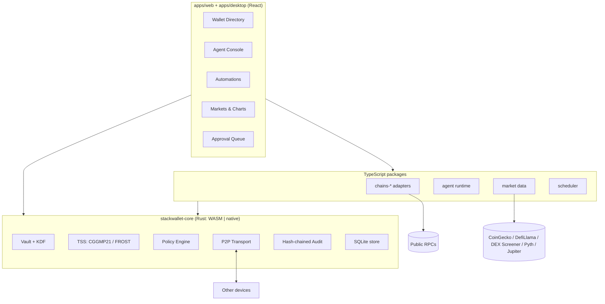
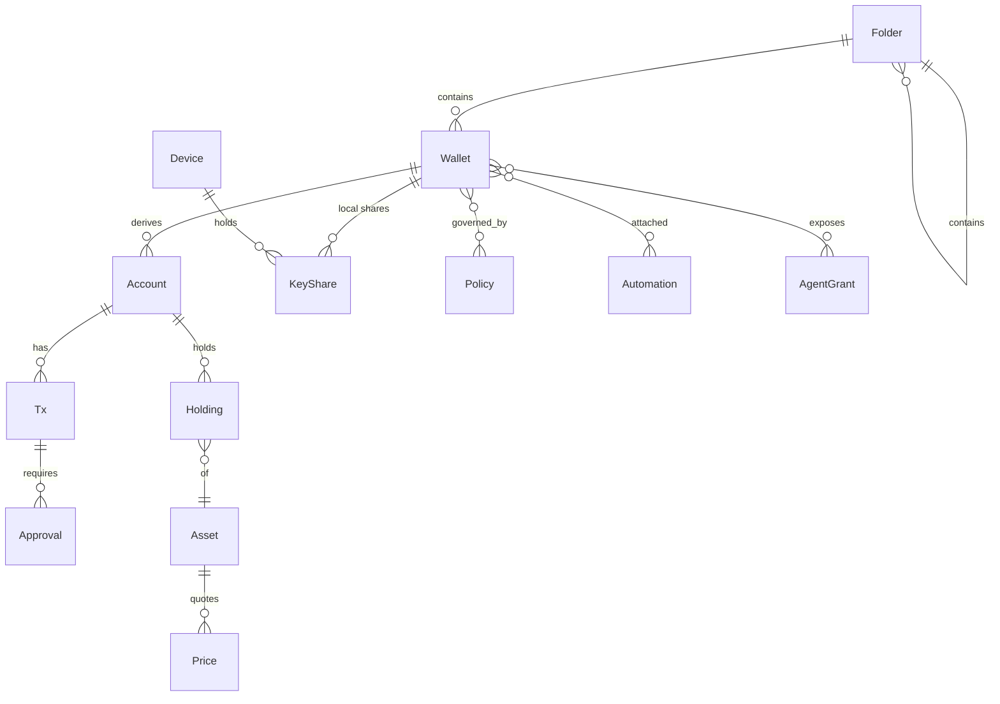
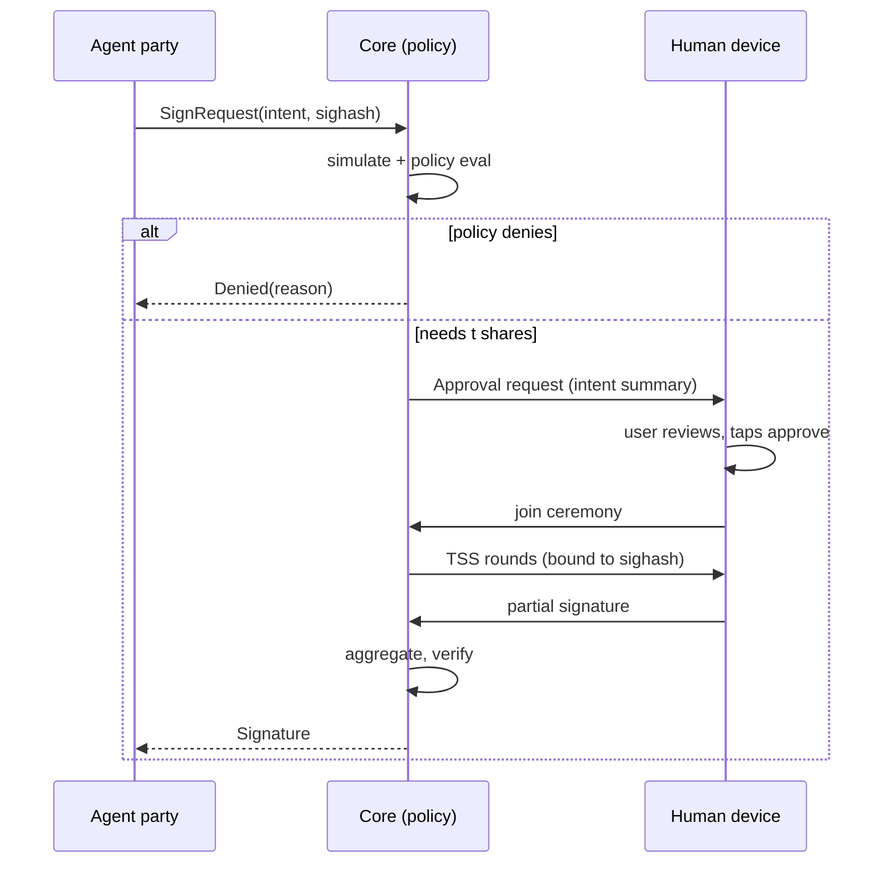
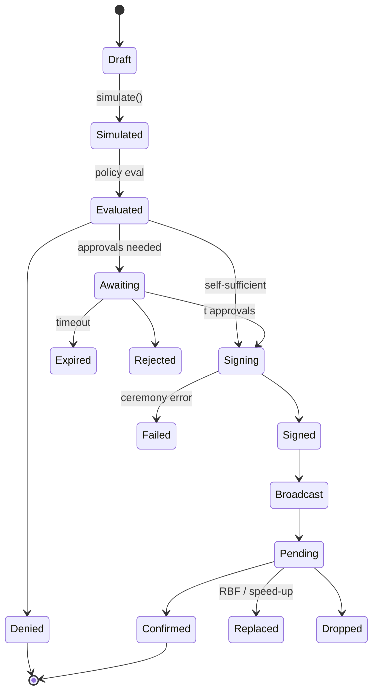

# StackWallet — Specification

Version 1. Companion documents: `SECURITY.md` (threat model), `DESIGN.md` (visual system),
`CHAINS.md` (adapter contract and per-family notes). Locked decisions D1–D9 are listed in
`AGENTS.md` and repeated in section 1; everything else in this document is open to revision.

## 0. What StackWallet is

StackWallet is an agentic harness for crypto wallets. It looks like any other agent harness
(a console where a model plans and calls tools, with the operator approving what matters), but
the tools act on wallets, and the wallets exist on every chain family: EVM, Bitcoin, Solana,
Cosmos, and whatever comes next.

Three ideas make it different from a wallet with a chatbot bolted on:

1. **The directory.** Wallets live in folders and subfolders. A folder carries policies,
   automations and agent grants that its children inherit. You can keep a "Trading / Agent
   lanes / Solana memecoins" folder with tight caps next to a "Cold / Savings" folder nothing
   automated can touch.
2. **Threshold custody as the permission system.** A `tss` wallet's key is split into shares
   held by your devices and, optionally, by the agent runtime. The agent can only ever be one
   party, and every threshold that includes it also needs a non-agent share. "The agent needs my
   approval to spend" is therefore a property of the math, not of a checkbox.
3. **Local-first, no server.** Every byte of state lives on your devices. Devices talk to each
   other directly for sync and signing ceremonies. Prices come straight from public APIs.

Platforms: web app (static bundle) and Tauri 2 desktop first; Android/iOS later through the
same Rust core (UniFFI).

## 1. Locked decisions

| #   | Decision                                                                                                                                                                                                    |
| --- | ----------------------------------------------------------------------------------------------------------------------------------------------------------------------------------------------------------- |
| D1  | Threshold signatures from day one. CGGMP21 for secp256k1 ECDSA (EVM, Bitcoin legacy/SegWit, Cosmos), FROST for Ed25519 (Solana) and secp256k1-Taproot (Bitcoin Schnorr).                                    |
| D2  | Rust core owns key material, encryption, TSS, the policy engine, transport and the audit log. WASM for web, native for Tauri, UniFFI later. TypeScript owns UI and chain-SDK glue only.                     |
| D3  | No server. Device-to-device sync and ceremonies (LAN discovery + WebRTC, QR pairing). Client-side market data.                                                                                              |
| D4  | BYOK cloud model providers (Anthropic, OpenAI, Google, OpenRouter) via the Vercel AI SDK. Keys live in the vault. Local models are a later provider.                                                        |
| D5  | V1 chain families: EVM (any chain via registry), Bitcoin family (BTC, LTC, DOGE), Solana, Cosmos SDK (+IBC).                                                                                                |
| D6  | The agent cannot move funds alone: at most one TSS party, and every agent-inclusive threshold requires a non-agent share. Enforced by the core at wallet creation and re-checked by policy at signing time. |
| D7  | Night glass design family (see `DESIGN.md`).                                                                                                                                                                |
| D8  | No telemetry, analytics or remote fonts. Reproducible builds.                                                                                                                                               |
| D9  | No time estimates anywhere. Phases only.                                                                                                                                                                    |

## 2. Architecture



### 2.1 Trust boundaries

- **Core** (Rust): the only code that touches shares, seeds, the data encryption key, or the
  policy decision. Exposed to TypeScript as opaque handles plus JSON-serializable requests and
  results. Never returns secret bytes.
- **Chain adapters** (TypeScript): build unsigned transactions, compute sighashes, simulate,
  assemble signatures, broadcast. They receive public keys and signatures only.
- **Agent runtime** (TypeScript): receives tool results and proposal status. Never receives
  keys, shares, RPC credentials, or provider keys in plaintext (the runtime asks the core to
  sign provider requests' authorization headers through a scoped handle).
- **UI** (React): renders state from the store and sends intents. UI checks are convenience;
  the core re-validates everything.

### 2.2 Runtime shapes

| Surface                 | Core runs as               | Store                             | Transport                                                                             | Scheduler                                     |
| ----------------------- | -------------------------- | --------------------------------- | ------------------------------------------------------------------------------------- | --------------------------------------------- |
| Browser                 | WASM in a dedicated Worker | SQLite-WASM over OPFS             | WebRTC data channels; SDP via a paired desktop on the LAN or via QR/paste             | Only while a tab is open (UI says so)         |
| Desktop (Tauri 2)       | Native, in-process         | rusqlite file in the app data dir | mDNS discovery + direct TCP with Noise; also acts as LAN signaling point for browsers | Background (tokio)                            |
| CLI (`stackwallet-cli`) | Native                     | rusqlite file                     | Same as desktop, headless                                                             | Background; the recommended automation device |
| Mobile (later)          | Native via UniFFI          | SQLite                            | WebRTC / LAN                                                                          | Push-less: foreground + OS background tasks   |

## 3. Repository layout

```
StackWallet/
  AGENTS.md
  docs/SPEC.md  SECURITY.md  DESIGN.md  CHAINS.md
  crates/
    stackwallet-core/        model, intent, policy, lifecycle, audit, vault, tss, transport, store
    stackwallet-wasm/        wasm-bindgen surface
    stackwallet-cli/         headless binary
  apps/
    web/                     Vite React SPA (static)
    desktop/                 Tauri 2 shell; `src-tauri` is the `stackwallet-tauri` crate
  packages/
    core-client/             TS types (Zod) + CoreClient over WASM or Tauri IPC
    chains/                  ChainAdapter contract, registry, shared tx model
    chains-evm/ chains-bitcoin/ chains-solana/ chains-cosmos/
    agent/  automations/  market/  ui/
```

Conventions: TypeScript strict; Zod at every boundary; INTEGER ms timestamps; TEXT uuid
primary keys; every lifecycle transition writes `audit_log`.

## 4. Domain model



### 4.1 Entities

**Folder** `{ id, parentId?, name, color?, tags[], defaultPolicyIds[], createdAt, updatedAt }`
Unlimited depth. Policies and tags are inherited by children; the effective policy of a wallet is
the composition of every ancestor folder's policies, its own, and the active grant's overlay.

**Wallet** `{ id, folderId, name, kind, keyGroupId?, tags[], notes?, createdAt, updatedAt }`
Kinds:

- `tss`: threshold wallet over a `KeyGroup` (t-of-n). One key per curve (secp256k1-ecdsa,
  ed25519, secp256k1-tr), so one wallet exposes accounts on every chain family.
- `single`: BIP39 seed, BIP32/SLIP-10 derivation, encrypted locally. For imports and throwaways.
- `watch`: addresses only, no signing.
- `hardware`: Ledger (WebHID / HID) as signer. Later phase.

**KeyGroup** `{ id, threshold, parties: PartyRef[], curves: Curve[], publicKeys: Record<Curve, hex>, createdAt, refreshedAt }`
`PartyRef = { deviceId, role: 'human' | 'agent' | 'automation' }`. Invariant (D6): if any party
has role `agent`, then `threshold > count(parties where role === 'agent')`.

**Account** `{ id, walletId, family, chainId, address, derivationPath?, publicKey, label? }`
Derived from the wallet's public key for the family's curve. Accounts can be hidden but never
deleted while they have history.

**KeyShare** (core-private) `{ id, keyGroupId, curve, deviceId, encryptedShare, createdAt }`
Never leaves the core in plaintext. Backups are share-level and encrypted to a recovery passphrase.

**Device** `{ id, name, kind: 'desktop' | 'browser' | 'cli' | 'mobile', identityPubKey, pairedAt, lastSeenAt, endpoints[] }`
Identity key is Ed25519, generated at install, held in the vault. Pairing pins both identities.

**Policy** `{ id, name, rules: Rule[], mode: 'enforce' | 'audit' }`
Rules (all evaluated deterministically in the core; see section 7):

- `spendCap { window: 'tx' | '1h' | '24h' | '7d' | '30d', usd?: number, native?: { chainId, amount } }`
- `destinationAllow { addresses[] }`, `destinationDeny { addresses[] }`
- `chainAllow { chainIds[] }`, `contractAllow { chainId, addresses[] }`
- `assetAllow { assetRefs[] }`
- `timeWindow { tz, days[], startMinute, endMinute }`
- `maxSlippageBps { bps }`
- `requireSimulationPass {}`
- `requireApprovers { deviceIds[], atLeast }`
- `cooldown { seconds }`
- `maxPendingProposals { count }`
  Composition: most restrictive wins (caps are min'd, allowlists are intersected, denylists are
  unioned, requirements are unioned).

**AgentGrant** `{ id, name, walletIds[] | folderIds[], toolAllow[], policyOverlayId?, providerId, modelId, createdAt, expiresAt? }`

**Automation** `{ id, name, walletIds[], trigger, conditions[], action, policyOverlayId?, enabled, lastRunAt?, nextRunAt? }`
See section 10.

**Tx** `{ id, accountId, chainId, intent, unsigned?, simulation?, state, approvals[], hash?, error?, createdAt, updatedAt }`
See section 6.

**Asset** `{ ref: "<chainId>:<kind>:<identifier>", symbol, name, decimals, logo?, sources{} }`
Examples: `eip155:1:erc20:0xa0b8…`, `bip122:000000000019d6…:native`, `solana:mainnet:spl:EPjF…`,
`cosmos:osmosis-1:ibc/27394F…`. Chain ids follow CAIP-2.

**Price** `{ assetRef, quote: 'usd', value, source, fetchedAt, confidence }`
**Holding** `{ accountId, assetRef, amount, updatedAt }`

### 4.2 Storage

SQLite everywhere (rusqlite natively, SQLite-WASM over OPFS in the browser). The whole database
is encrypted at rest with XChaCha20-Poly1305 using a data encryption key (DEK). The DEK is
wrapped by Argon2id(passphrase) and optionally by a platform unlock (WebAuthn PRF in the browser,
OS keychain / Windows Hello on desktop). Share material is additionally encrypted with a
per-share key derived from the DEK so a compromised DB export without the passphrase yields
nothing usable.

Sync between devices is a CRDT-free, explicit model: each device keeps its own DB; metadata
(folders, wallets, accounts, policies, automations, grants, tx records) is exchanged as signed
change sets over the P2P channel, last-writer-wins per row with vector clocks for conflict
visibility. Shares are never synced; they are created in place by DKG or moved by re-sharing.

## 5. Threshold signing

### 5.1 Protocols

| Curve                      | Chains                             | Protocol                                                  | Implementation         |
| -------------------------- | ---------------------------------- | --------------------------------------------------------- | ---------------------- |
| secp256k1 ECDSA            | EVM, Bitcoin legacy/SegWit, Cosmos | CGGMP21 (DKG, auxiliary info, presign, sign, key refresh) | `cggmp21` crate family |
| Ed25519                    | Solana (Sui/Aptos later)           | FROST                                                     | `frost-ed25519`        |
| secp256k1 Schnorr (BIP340) | Bitcoin Taproot                    | FROST                                                     | `frost-secp256k1-tr`   |

Each `tss` wallet runs DKG once per curve so one wallet covers all families. Key refresh rotates
share material without changing public keys; re-sharing changes the party set (device add or
remove) without changing public keys.

### 5.2 Parties

- **Human devices**: desktop, browser, later phone. Unlock with the user's passphrase or platform
  unlock before a share participates.
- **Agent party**: a share scoped to the agent runtime on one device. It unlocks with an
  agent-scoped key (no user passphrase) but only after the grant's policy overlay passes.
- **Automation device**: the headless CLI on an always-on machine with its own policy.

Example setups:

- 2-of-3 `{laptop, phone, agent}`: the agent proposes and co-signs, a human finishes.
- 2-of-2 `{laptop, phone}`: savings; the agent can read but never sign.
- 2-of-3 `{automation-cli, agent, laptop}` with a tight overlay: an "autonomous lane" where
  automation and agent can complete small, allowlisted transactions without a human.
- 3-of-5 across trusted people's devices.

### 5.3 Transport (device-to-device only)

- **Pairing**: one device shows a QR carrying `{deviceId, identityPubKey, endpoints[], oneTimeCode}`;
  the other scans or pastes it. A Noise-IK handshake with the one-time code as a PSK pins both
  identities. Pairing happens once; later sessions reuse the pinned identity.
- **Discovery**: desktop and CLI advertise `_stackwallet._tcp` via mDNS. Browsers cannot do mDNS,
  so a paired desktop acts as the LAN signaling point for browser peers (SDP offers/answers over
  the already-authenticated channel). Two browsers with no desktop exchange SDP via QR or paste.
- **Channel**: WebRTC data channels in the browser; direct TCP with Noise between desktop/CLI.
  Every protocol message is authenticated by the device identity and bound to a `sessionId` and
  the exact `SignRequest` hash, so a party cannot be tricked into signing a different payload
  mid-ceremony.
- **Resumption**: presignatures (CGGMP21) and nonce pre-commitment (FROST) let parties pre-commit
  so a phone's co-sign is one round when the request arrives. Ceremonies have a TTL; expired
  presignatures are discarded, never reused.



## 6. Transaction lifecycle



Rules:

- Every transition writes an `audit_log` row whose hash covers the previous row's hash, the tx id,
  the from/to states, the actor (device, agent session, automation) and a timestamp. The UI can
  verify the chain and shows a break as a red banner.
- `Draft → Simulated` is mandatory when any effective policy has `requireSimulationPass`; it is
  always attempted and a failed simulation is shown to approvers regardless.
- `Evaluated → Signing` without `Awaiting` happens only when the local device alone satisfies the
  threshold (single-key wallets, or a `tss` wallet whose threshold is met by local shares, which
  D6 forbids for agent-inclusive groups).
- Approval screens always show: decoded intent, simulated asset deltas, destination reputation
  (allowlist status, first-seen date for this directory), USD value, policy headroom remaining in
  each window, and who proposed it (human, agent session with rationale, automation run).

## 7. Policy engine

Pure, deterministic Rust (`stackwallet_core::policy`). Input: `TxIntent`, `Simulation?`,
`PolicyContext` (effective rules, spend ledger per window, clock, approver set online). Output:
`Decision::Allow { requiredApprovers }`, `Decision::Deny { reasons[] }`, or
`Decision::Audit { wouldDeny: reasons[] }` for `audit`-mode policies.

Properties the tests must hold:

- Composition is order-independent.
- A denylist always beats an allowlist.
- Caps are evaluated against the ledger including currently `Awaiting`/`Signing` transactions
  (reserved spend), not only confirmed ones.
- An agent-inclusive key group whose threshold could be met by agent shares alone is denied at
  evaluation time even if the wallet somehow exists (defense in depth for D6).

## 8. Chain adapters

Full contract and per-family notes in `CHAINS.md`. Summary:

```ts
interface ChainAdapter {
  family: ChainFamily;
  chains(): ChainInfo[];
  deriveAddress(pub: PublicKey, chain: ChainId): Address;
  getBalances(addr: Address, chain: ChainId): Promise<Holding[]>;
  getHistory(addr: Address, chain: ChainId, cursor?: string): Promise<Page<TxRecord>>;
  build(intent: TxIntent, chain: ChainId): Promise<UnsignedTx>;
  simulate(tx: UnsignedTx): Promise<Simulation>;
  sighashes(tx: UnsignedTx): SignRequest[];
  attach(tx: UnsignedTx, sigs: Signature[]): SignedTx;
  broadcast(tx: SignedTx): Promise<TxHash>;
  status(hash: TxHash, chain: ChainId): Promise<TxStatus>;
  rpc: RpcPool;
}
```

Swaps use aggregator quotes (0x / 1inch / LI.FI for EVM, Jupiter for Solana, Skip / Osmosis for
Cosmos) and still pass simulation and policy; `maxSlippageBps` is a policy rule, not a UI field.

## 9. Agent runtime

- **Providers**: Vercel AI SDK with `@ai-sdk/anthropic`, `@ai-sdk/openai`, `@ai-sdk/google`,
  `@openrouter/ai-sdk-provider`. Provider keys live in the vault; requests are signed through a
  scoped core handle so the runtime never holds the raw key.
- **Tools** (Zod-typed, all logged): `listWallets`, `getPortfolio`, `getPrice`, `getHistory`,
  `quoteSwap`, `proposeTransfer`, `proposeSwap`, `proposeContractCall`, `simulate`,
  `requestSignature`, `createAutomation`, `readChart`, `search` (optional, off by default).
  Any tool producing a `TxIntent` enters the lifecycle of section 6. The agent never receives a
  signer.
- **Run loop**: streamed tool-call loop with hard caps per session (max steps, max USD proposed,
  max pending proposals). Every proposal appears in the Approval Queue with the model's stated
  rationale and the exact tool arguments.
- **Grants**: a session runs under one `AgentGrant`. Pinning a session to a folder makes its
  grant equal that folder's wallets with that folder's policies.
- **Agent party**: a session may act as one TSS party only for wallets whose key group has an
  `agent` party on this device and whose grant permits it.
- **Untrusted input**: token names, calldata decodes, transaction memos, web content and tool
  results are untrusted. They are wrapped and labelled before reaching the prompt; destinations
  that come from such content and are not in the user's allowlists are flagged in the proposal.
- Sessions, transcripts and tool traces are stored locally and searchable.

## 10. Automations

- **Triggers**: `schedule(cron)`, `priceCondition(assetRef, op, value | percentOverWindow)`,
  `balanceCondition(accountId, assetRef, op, value)`, `chainEvent(polled log filter /
account change / UTXO arrival)`, `manual`, `agent`.
- **Conditions**: additional predicates evaluated at fire time (same evaluator as alerts).
- **Actions**: `transfer`, `swap`, `dca`, `rebalance(targetWeights)`, `sweepToCold`,
  `stake | claim`, `ibcTransfer`, `alertOnly`, `runAgentPrompt`.
- Each run yields `TxIntent`s that enter the lifecycle. An automation attached to a wallet whose
  threshold can be met by `{automation, agent}` shares is an **autonomous lane**; the UI labels it,
  and enabling it requires an explicit tight overlay (caps, allowlists, cooldown).
- Scheduler runs in the background on desktop and CLI; in the browser only while a tab is open,
  and the UI says so. Runs are idempotent by `(automationId, triggerKey)`.

## 11. Market data and charts

- **Sources** (client-side, per-source rate limiting and caching): CoinGecko (free tier),
  DefiLlama coins API, DEX Screener (long-tail DEX pairs), Pyth Hermes (low-latency majors),
  Jupiter price API (Solana), on-chain DEX quotes as the last resort. Every price carries
  `source`, `fetchedAt`, `confidence`; the UI shows provenance.
- **Asset registry** seeded from token lists (Uniswap, Jupiter strict, Cosmos chain-registry,
  CoinGecko id map) and extended by any asset seen in a holding.
- **Charts**: TradingView `lightweight-charts`. Candles from CoinGecko OHLC / DEX Screener /
  Pyth history. Portfolio value over time computed locally from holdings × historical prices;
  per-wallet, per-folder and global views; allocation and PnL breakdowns.
- **Alerts** reuse the automation condition evaluator.

## 12. UI surfaces

1. **Directory**: tree sidebar (folders / subfolders / wallets), bulk tag and move, folder-level
   totals, policy badges, agent-access badges.
2. **Wallet**: accounts by chain, holdings, history, policies, automations, grants,
   share-holders and threshold health (which parties are online).
3. **Agent Console**: chat, tool trace, proposals; model picker; grant picker.
4. **Approval Queue**: every pending signature across all wallets; decoded intent, simulation
   deltas, policy headroom, one-tap co-sign (opens the ceremony).
5. **Automations**: list, run history, next run, autonomous-lane warnings.
6. **Markets**: asset search, charts, watchlists, portfolio analytics.
7. **Devices**: pair, revoke, re-share, backup and recovery drills.
8. **Settings**: RPC endpoints, provider keys, unlock method, export/import encrypted vault.

## 13. Phases

0. **Scaffold**: repo, workspaces, AGENTS.md, SPEC/SECURITY/DESIGN/CHAINS, CI, design tokens,
   empty Tauri and web shells, core types (`TxIntent`, `SignRequest`, `Policy`, lifecycle, audit).
1. **Core vault + TSS**: encrypted SQLite store, device identity, DKG / sign / refresh for
   FROST-Ed25519 and CGGMP21, local multi-party test harness, CLI `pair` / `sign`.
2. **Transport**: QR pairing, Noise channel, WebRTC with LAN signaling via desktop, resumption.
3. **Directory + EVM**: folders / wallets / accounts UI, EVM adapter end to end on testnets,
   lifecycle + audit log, Approval Queue.
4. **Chains**: Bitcoin (PSBT, Taproot via FROST secp256k1-tr), Solana, Cosmos; swaps per family.
5. **Agent runtime**: providers, tools, run loop, grants, agent party.
6. **Automations + scheduler**: triggers / actions, headless CLI as automation device.
7. **Markets**: aggregation, registry, charts, portfolio analytics, alerts.
8. **Desktop polish + packaging**: Tauri bundles, background scheduler, OS keychain unlock,
   hardware wallet signer.
9. **Mobile**: UniFFI bindings, phone as a first-class share-holder and approver.

Support gates before any phase touches mainnet funds are listed in `SECURITY.md`.
